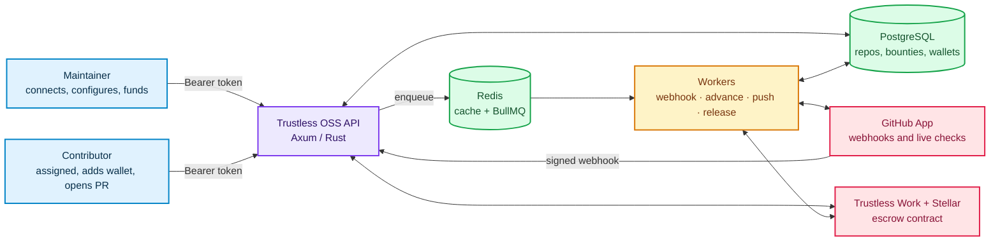
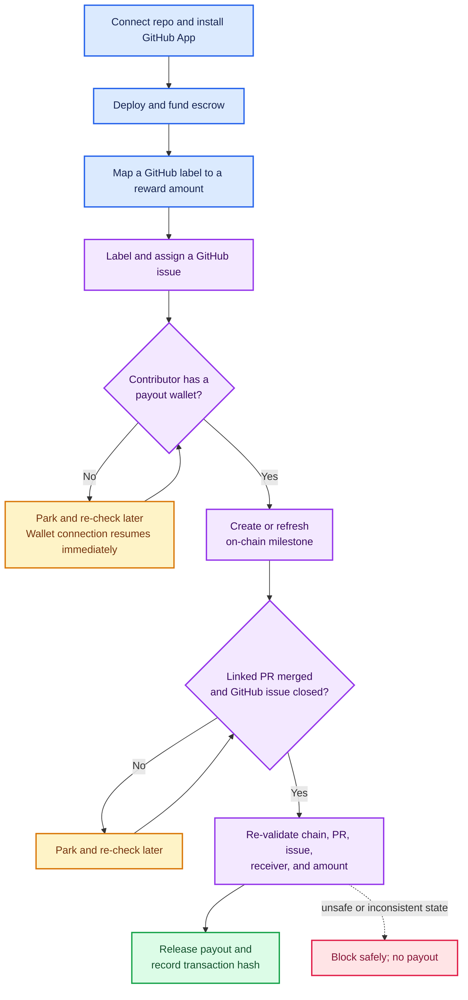
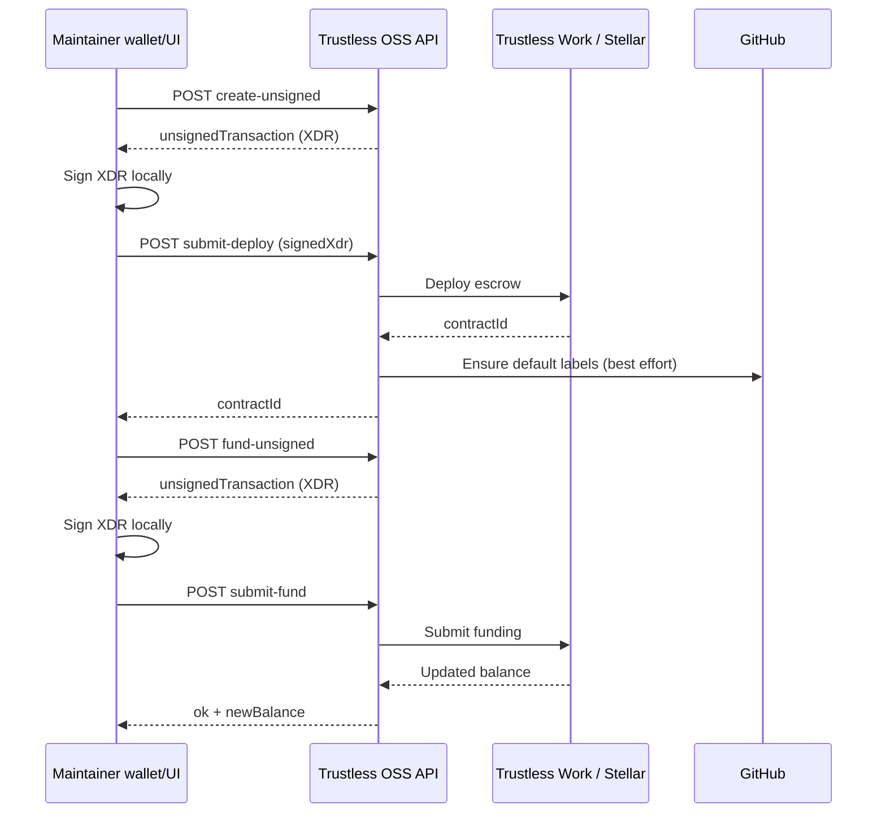

# Trustless OSS Backend — End-to-End API Guide

Trustless OSS connects GitHub issue work to escrowed USDC rewards. Maintainers connect repositories, deploy and fund an escrow, and configure label-based rewards. Contributors receive a bounty through normal GitHub assignment, add a payout wallet, and submit a linked pull request. The backend verifies the live GitHub and escrow state before releasing a payout.

This document describes the backend as implemented in this repository. The interactive OpenAPI contract is also available at `GET /swagger` while the service is running.

## Contents

- [Architecture and lifecycle](#architecture-and-lifecycle)
- [Run the service](#run-the-service)
- [Authentication, conventions, and errors](#authentication-conventions-and-errors)
- [Complete endpoint reference](#complete-endpoint-reference)
- [End-to-end workflows](#end-to-end-workflows)
- [Background automation and safety](#background-automation-and-safety)
- [Operations](#operations)

## Architecture and lifecycle

Trustless OSS keeps the HTTP API responsive: GitHub webhook delivery records an event and queues work; background workers make the slow GitHub and escrow calls. PostgreSQL is the source of application state, Redis supports caching and BullMQ queues, and Trustless Work performs escrow operations on Stellar.



### Bounty journey



## Run the service

### Prerequisites

- Rust toolchain compatible with the project (`rust-toolchain.toml`)
- Docker and Docker Compose for PostgreSQL and Redis
- A Supabase project using GitHub identity, a GitHub App, Stellar keys, and Trustless Work credentials for integration features

### Local start

```bash
cp .env.example .env
docker compose up -d
cargo run
```

The server defaults to `http://localhost:5000`. Migrations in `toasty/migrations` are applied on server start. Check readiness with:

```bash
curl http://localhost:5000/
curl http://localhost:5000/api/v1/health
```

The required configuration is documented in `.env.example`. In particular, do not expose private Stellar keys, the GitHub App private key, `GITHUB_WEBHOOK_SECRET`, or `TRUSTLESS_WORK_API_KEY` to browsers.

## Authentication, conventions, and errors

### Authentication modes

| Mode | Used by | Requirement |
| --- | --- | --- |
| Bearer authentication | User and maintainer API routes | `Authorization: Bearer <Supabase access token>`; the verified Supabase user must contain a usable GitHub identity. |
| GitHub signature | `POST /api/v1/webhooks/github` | GitHub's raw request body plus `X-Hub-Signature-256: sha256=<HMAC-SHA256>` made with `GITHUB_WEBHOOK_SECRET`. |
| Public | Root, health, queue statistics, issue list, public leaderboard | No bearer token required. Do not treat public operational endpoints as a private admin surface. |

The API verifies bearer tokens through Supabase Auth and derives the caller's GitHub numeric ID. Maintainer-only actions additionally check the repository-maintainer relation stored by the backend.

### Common request rules

- Send JSON bodies with `Content-Type: application/json`.
- UUID path parameters are written as `{repoId}`, `{issueId}`, or `{id}` below.
- Monetary values are decimal JSON numbers in requests. Responses serialize on-chain amounts as strings in most models to preserve precision.
- Datetimes are ISO-8601 UTC timestamps.
- Repository list and issue list use `limit` (default `100`, range `1–200`) and `offset` (default `0`, minimum `0`). Notification list uses `limit` (default `20`, range `1–100`) and `offset`.
- Dashboard/public leaderboard use `page` (default `1`) and `page_size` (default `20`, range `1–100`).
- A global IP limiter allows 30 requests per second. Wallet connection is limited to 10 attempts per user per minute; escrow routes are limited to 5 per user per minute.

### Error format

Application errors use a consistent body:

```json
{ "error": "Human-readable explanation" }
```

Typical statuses are `400` for invalid state or input, `401` for missing/invalid credentials, `403` for an authenticated caller without the required role, `404` for absent resources, `429` for a rate limit, and `500` for integration or server failures. Health routes use `503` when a required dependency is unavailable or shutdown is underway.

### Useful shell variables

```bash
export API_URL="http://localhost:5000"
export ACCESS_TOKEN="<supabase-access-token>"
export AUTH_HEADER="Authorization: Bearer $ACCESS_TOKEN"
```

### Core records and identifiers

| Record | Identifier used by APIs | Important lifecycle fields |
| --- | --- | --- |
| Repository | Backend UUID (`repoId`), plus immutable GitHub numeric repository ID | `fullName`, optional `escrowContractId`, cached `escrowBalance`, reward mappings |
| Reward | Backend UUID; addressed through its repository and label in write APIs | `label` → `amount` mapping used when the label is applied to an issue |
| Bounty | Backend UUID (`issueId` in bounty-control routes), plus GitHub issue ID and issue number | `open` → `assigned` → `merged` → `paid`, or `cancelled`; optional `milestoneIndex` and `payoutTxHash` |
| Profile | Internal UUID and GitHub numeric ID | GitHub username, optional contact/profile data, payout wallets |
| Wallet | Internal UUID | Chain, address, and primary-wallet flag |
| Notification | UUID (`id`) | Kind, optional bounty/reference ID and data, `isRead`, timestamp |

Do not substitute a GitHub issue number for the backend bounty UUID in `/api/v1/issues/{issueId}/…`. GitHub issue IDs are used only where a request explicitly names `githubIssueId`.

## Complete endpoint reference

### System, health, and queue

| Method and path | Auth | Purpose | Successful response |
| --- | --- | --- | --- |
| `GET /` | Public | Confirms the HTTP service is running. | `{ service, status, message }` |
| `GET /health` | Public | Full health check for database, Redis, environment, and Trustless Work. | `200` / `503`, including `checks` |
| `GET /api/v1/health` | Public | Versioned alias of the full health check. | Same as `/health` |
| `GET /api/v1/health/database` | Public | PostgreSQL reachability and latency. | `{ service, status, timestamp, latency }` |
| `GET /api/v1/health/redis` | Public | Redis reachability and latency. | Same dependency shape |
| `GET /api/v1/health/trustless-work` | Public | Trustless Work reachability and latency. | Same dependency shape |
| `GET /api/v1/queue/stats` | Public | Live BullMQ counts for webhook, bounty/escrow, and sync queues. | Queue-count object |
| `GET /swagger` | Public | Swagger UI generated from the OpenAPI specification. | HTML |
| `GET /api/v1/doc/openapi.json` | Public | Machine-readable OpenAPI document. | OpenAPI JSON |

Queue statistics use the following shape. `escrow-operations` is the bounty queue; completed bounty jobs are removed immediately, so its `completed` count normally remains zero.

```json
{
  "webhooks": { "waiting": 0, "active": 0, "completed": 0, "failed": 0, "delayed": 0 },
  "escrow-operations": { "waiting": 0, "active": 0, "completed": 0, "failed": 0, "delayed": 0 },
  "sync": { "waiting": 0, "active": 0, "completed": 0, "failed": 0, "delayed": 0 }
}
```

### Repository and reward management

| Method and path | Auth | Purpose | Request body / query |
| --- | --- | --- | --- |
| `GET /api/v1/repos` | Bearer | Lists repositories visible to the caller. | `?limit=&offset=` |
| `POST /api/v1/repos/connect` | Bearer | Connects one repository and attempts webhook setup. | [`Connect repository`](#connect-a-repository) |
| `GET /api/v1/repos/installation-repos` | Bearer | Lists non-fork, non-private repositories available to a GitHub App installation. | `?installationId=<integer>`; `installation_id` is also accepted |
| `POST /api/v1/repos/sync-installation` | Bearer | Imports selected repositories from a GitHub App installation. | `{ "installationId": 123, "githubRepoId": 456 }` or `githubRepoIds` array; snake-case aliases are accepted |
| `GET /api/v1/repos/{repoId}` | Bearer | Returns a repository, maintainer flag, escrow state, and capability flags. | — |
| `DELETE /api/v1/repos/{repoId}` | Bearer, maintainer | Disconnects the repository. | — |
| `GET /api/v1/repos/{repoId}/issues` | Public | Lists bounty/issue records stored for a repository. | `?limit=&offset=` |
| `PUT /api/v1/repos/{repoId}/rewards` | Bearer, maintainer | Creates or updates the reward amount for a GitHub label. | `{ "label": "bounty:small", "amount": 25 }` |
| `GET /api/v1/repos/rewards/{repoId}` | Bearer | Returns the repository's configured reward levels. | — |
| `GET /api/v1/repos/{repoId}/github-labels` | Bearer | Fetches labels from GitHub for this repository. | — |
| `DELETE /api/v1/repos/{repoId}/rewards/{label}` | Bearer, maintainer | Deletes a reward mapping; may also remove the GitHub label. | `{ "alsoDeleteGithubLabel": false }` |

`GET /api/v1/repos` and issue list responses have this envelope:

```json
{ "data": [], "total_count": 0, "limit": 100, "offset": 0 }
```

A repository contains its internal `id`, GitHub IDs, `full_name`, escrow contract and cached balance when available, reward levels, and `created_at`. Repository detail adds `is_maintainer`, `escrow_deployed`, `escrow_status`, and `can_deploy_escrow`, `can_fund_escrow`, `can_close_escrow`, and `can_refund_escrow` flags.

#### Connect a repository

`POST /api/v1/repos/connect` accepts camel-case field names:

```json
{
  "ghRepoId": 123456789,
  "fullName": "owner/project",
  "ownerGhId": 12345,
  "ownerUsername": "maintainer",
  "ghToken": "github-token"
}
```

It returns `{ "repo": { ... } }`. Prefer the installation-sync flow when using the GitHub App. `connect` remains useful when the client has the repository and owner details and must establish the connection directly.

### Contributor profile and payout wallet

| Method and path | Auth | Purpose | Request body |
| --- | --- | --- | --- |
| `POST /api/v1/wallet/connect` | Bearer | Saves the caller's payout wallet. For Stellar, validates the account for USDC payout use; also resumes non-settled bounties assigned to the user. | `{ "wallet": "G...", "payoutChain": "stellar", "payoutAddress": "G..." }` |
| `GET /api/v1/contributor/me` | Bearer | Gets the current profile, selected wallet fields, and assigned bounty summaries. | — |
| `PUT /api/v1/contributor/profile` | Bearer | Updates optional profile fields. | `{ "fullName": "…", "bio": "…", "location": "…", "website": "…", "skills": "…", "telegram": "…", "discord": "…", "twitter": "…" }` |

`wallet` is always required. `payoutChain` defaults to `stellar`; `payoutAddress` defaults to `wallet`. Successful wallet connection returns `{ "ok": true }`.

### Escrow lifecycle

The escrow API is intentionally a two-step signing protocol. The backend creates an unsigned XDR transaction; the client signs it with the relevant Stellar wallet; the backend submits the signed XDR to Trustless Work. This keeps user wallet signatures on the client side.

New escrows include the Trustless OSS platform fee configured in `TOSS_PLATFORM_FEE_BPS` (`100` basis points = `1%`). Trustless Work collects it on each successful milestone release and sends it to the escrow's `platformAddress`, which this backend sets from `PLATFORM_STELLAR_PUBLIC_KEY`. On mainnet, Trustless Work also applies its separate `0.3%` protocol fee. Existing escrows retain the fee configuration with which they were deployed.

| Method and path | Auth | Purpose | Request body |
| --- | --- | --- | --- |
| `POST /api/v1/escrow/create-unsigned` | Bearer, maintainer | Builds unsigned escrow deployment XDR. | `{ "repoId": "uuid", "maintainerWallet": "G..." }` |
| `POST /api/v1/escrow/submit-deploy` | Bearer, maintainer | Submits signed deployment and records the contract. Creates default repository labels on a best-effort basis. | `{ "repoId": "uuid", "signedXdr": "..." }` |
| `POST /api/v1/escrow/fund-unsigned` | Bearer, maintainer | Builds unsigned funding XDR. Escrow must already exist; amount must be positive. | `{ "repoId": "uuid", "amount": 100, "funderWallet": "G..." }` |
| `POST /api/v1/escrow/submit-fund` | Bearer, maintainer | Submits signed funding and updates the recorded balance. | `{ "repoId": "uuid", "amount": 100, "funderWallet": "G...", "signedXdr": "..." }` |
| `POST /api/v1/escrow/refund` | Bearer, maintainer | Refunds the escrow and cancels open bounty records. | `{ "repoId": "uuid", "maintainerWallet": "G..." }` |
| `POST /api/v1/escrow/close-unsigned` | Bearer, maintainer | Builds unsigned escrow-close XDR. | `{ "repoId": "uuid", "maintainerWallet": "G..." }` |
| `POST /api/v1/escrow/submit-close` | Bearer, maintainer | Submits a signed escrow-close transaction. | `{ "repoId": "uuid", "signedXdr": "..." }` |

Unsigned endpoints return `{ "unsignedTransaction": "..." }`. Deployment returns `{ "contractId": "..." }`; fund submission returns `{ "ok": true, "newBalance": "..." }`; refund returns `{ "refundedAmount": "...", "cancelledIssues": 0 }`; close submission returns `{ "ok": true }`.

### Bounty controls

Most bounty advancement is event-driven; these endpoints are the client-facing lifecycle controls.

| Method and path | Auth | Purpose | Request body |
| --- | --- | --- | --- |
| `POST /api/v1/milestones/push` | Bearer, assigned contributor | Saves the contributor payout wallet for an eligible issue and queues the automation state machine. | `{ "githubIssueId": 1, "githubRepoId": 2, "wallet": "G...", "payoutChain": "stellar", "payoutAddress": "G..." }` |
| `POST /api/v1/issues/{issueId}/retry` | Bearer, maintainer | Requests an immediate safe re-evaluation. It cannot force an unsafe payout. | — |
| `POST /api/v1/issues/{issueId}/reject` | Bearer, maintainer | Rejects an unpaid bounty, returns its reserved reward to the pool, and notifies the assignee. | — |
| `POST /api/v1/issues/{issueId}/hold` | Bearer, maintainer | Places a dispute hold on an on-chain milestone. | — |

`issueId` in these paths is the backend bounty UUID, not the GitHub issue number. A milestone-push response is `{ "ok": true, "repoFullName": "owner/repo", "issueNumber": 42 }`. Retry normally responds with `{ "ok": true, "step": "queued", "message": "The bounty state machine will run shortly" }`.

### Notifications

| Method and path | Auth | Purpose | Request body / query |
| --- | --- | --- | --- |
| `GET /api/v1/notifications` | Bearer | Lists the caller's notifications, newest first. | `?limit=&offset=` |
| `GET /api/v1/notifications/unread-count` | Bearer | Gets the caller's unread notification count. | — |
| `POST /api/v1/notifications/read-all` | Bearer | Marks all of the caller's notifications as read. | — |
| `POST /api/v1/notifications/{id}/read` | Bearer | Marks one owned notification as read. | — |

A notification includes `id`, `kind`, `title`, optional `body`, `isRead`, optional `refId` and `data`, and `createdAt`.

### Tickets

| Method and path | Auth | Purpose | Request body |
| --- | --- | --- | --- |
| `POST /api/v1/tickets` | Bearer | Creates a ticket owned by the authenticated contributor. | `{ "org": "owner/repo", "category": "bug", "subject": "Unable to connect wallet", "message": "Details...", "attachmentKey": "uploads/file.png", "bountyId": "uuid" }` |
| `GET /api/v1/tickets/{ticketId}` | Bearer, owner | Retrieves one of the caller's tickets. | — |
| `PATCH /api/v1/tickets/{ticketId}` | Bearer, owner | Updates fields on the caller's open ticket. Omitted or `null` fields are left unchanged; provide at least one non-null field. | `{ "subject": "Updated subject" }` |
| `POST /api/v1/tickets/{ticketId}/resolve` | Bearer, owner | Marks the caller's ticket resolved; repeated requests are safe. | — |

Ticket creation requires a non-empty `category`, `subject`, and `message`. Their maximum lengths are 100, 200, and 10,000 characters. Optional `org` and `attachmentKey` values are limited to 200 and 1,024 characters. Ticket IDs are UUIDs. Other users' tickets are returned as `404`.

### Dashboard and leaderboard

| Method and path | Auth | Purpose | Query |
| --- | --- | --- | --- |
| `GET /api/v1/dashboard/activity` | Bearer | Maintainer-scoped activity feed, newest first. | — |
| `GET /api/v1/dashboard/summary` | Bearer | Maintainer aggregate metrics: locked/released funds, rewarded issues, contributors. | — |
| `GET /api/v1/dashboard/funds-movement` | Bearer | Monthly cumulative escrow TVL and payouts. | — |
| `GET /api/v1/dashboard/leaderboard` | Bearer | Leaderboard restricted to repositories maintained by the caller. | `?page=&page_size=` |
| `GET /api/leaderboard` | Public | Platform-wide aggregate leaderboard; cached for 180 seconds. | `?page=&page_size=` |

Leaderboard responses are `{ "items": [], "page": 1, "pageSize": 20, "total": 0, "totalPages": 0 }`. Each entry has `rank`, `name`, `earnedUsdc`, `mergedPrs`, `assigned`, and `repos`.

### GitHub webhook

| Method and path | Auth | Purpose | Result |
| --- | --- | --- | --- |
| `POST /api/v1/webhooks/github` | GitHub HMAC | Accepts GitHub App deliveries, verifies the raw body signature, and queues supported event processing. | `202 Accepted` |

Required headers are `X-Hub-Signature-256`, `X-GitHub-Event`, and preferably `X-GitHub-Delivery` for delivery deduplication. The backend handles installation changes inline; other supported deliveries are queued when Redis is available and processed inline as a degraded fallback when it is not. Supported events include issue label/assignment/unassignment/closure/deletion, created issue comments, merged pull requests, installation, and installation-repository changes.

## End-to-end workflows

### 1. Maintainer: connect, deploy, fund, and configure

1. Install the GitHub App for the desired repositories. GitHub sends installation webhooks, or use `GET /api/v1/repos/installation-repos` then `POST /api/v1/repos/sync-installation` to import the selected repository records.
2. Obtain the Trustless OSS repository UUID from `GET /api/v1/repos` or `GET /api/v1/repos/{repoId}`.
3. Build an unsigned deployment transaction, sign its XDR with the maintainer's Stellar wallet, then submit it.
4. Build a funding transaction, sign its XDR, then submit it.
5. Map the GitHub labels that should create rewards to amounts.



Example deployment request:

```bash
curl -X POST "$API_URL/api/v1/escrow/create-unsigned" \
  -H "$AUTH_HEADER" -H 'Content-Type: application/json' \
  -d '{"repoId":"<repo-uuid>","maintainerWallet":"G..."}'
```

After signing the returned `unsignedTransaction` in the wallet client:

```bash
curl -X POST "$API_URL/api/v1/escrow/submit-deploy" \
  -H "$AUTH_HEADER" -H 'Content-Type: application/json' \
  -d '{"repoId":"<repo-uuid>","signedXdr":"<signed-xdr>"}'
```

Configure a label:

```bash
curl -X PUT "$API_URL/api/v1/repos/<repo-uuid>/rewards" \
  -H "$AUTH_HEADER" -H 'Content-Type: application/json' \
  -d '{"label":"bounty:small","amount":25}'
```

### 2. Contributor: receive and complete a bounty

1. A maintainer applies a configured reward label to a GitHub issue and assigns the contributor. GitHub sends the events to the backend.
2. The contributor connects a Stellar payout wallet using `POST /api/v1/wallet/connect`. This wakes any bounty waiting for that wallet.
3. The automation pushes a milestone into escrow and posts/creates notifications. The contributor works normally in GitHub.
4. The contributor's pull request must be merged, reference the issue, and be authored by the assigned contributor. The GitHub issue must also be closed.
5. The worker rechecks live GitHub and escrow state, releases the payout, stores the transaction hash, and marks the bounty paid.

Wallet example:

```bash
curl -X POST "$API_URL/api/v1/wallet/connect" \
  -H "$AUTH_HEADER" -H 'Content-Type: application/json' \
  -d '{"wallet":"G...","payoutChain":"stellar","payoutAddress":"G..."}'
```

The more targeted `POST /api/v1/milestones/push` is available only to the assigned contributor. It records the wallet for a specified eligible GitHub issue and queues the same safe automation; it does not itself send a payout.

### 3. Maintainer: intervene safely

- Use `retry` only as an escape hatch. It causes a fresh evaluation using the same live rules; it does not bypass escrow, PR, or ownership checks.
- Use `hold` to dispute an unpaid milestone already pushed on chain.
- Use `reject` to cancel an unpaid bounty and return the reserved reward to the available pool.
- Use `refund` to refund an escrow and cancel open bounties. The backend posts cancellation comments where possible and notifies assigned contributors.

## Background automation and safety

### Queue model

| Queue | Jobs | Purpose |
| --- | --- | --- |
| `toss-webhooks` | `github-webhook` | Processes signed GitHub deliveries; default concurrency is `BULLMQ_CONCURRENCY` or `4`. |
| `toss-bounty` | `advance-issue`, `push-milestone`, `release-payout` | Serializes money-related work at concurrency `1`. |

Webhook jobs retry up to five times with exponential backoff from two seconds. Bounty jobs retry up to five times with exponential backoff from five seconds. Permanent failures remain observable as failed jobs; retryable infrastructure failures are retried automatically.

The queue id is stable per GitHub delivery or bounty. Duplicate deliveries and event bursts therefore collapse rather than creating duplicate payouts. If Redis is unavailable at boot, the API still starts; queues/workers are disabled and webhooks/bounty progression use the available inline fallback behavior.

### Release conditions

A payout is released only when all relevant conditions are satisfied:

1. The bounty is not cancelled or already paid.
2. It has an assigned contributor and a non-empty payout wallet.
3. The repository has an escrow contract and a corresponding on-chain milestone.
4. The on-chain receiver matches the contributor's current wallet.
5. The stored reward is positive and no greater than the escrow milestone amount.
6. The linked pull request is merged, still references the GitHub issue, and belongs to the assigned contributor.
7. The GitHub issue is currently closed.

The chain is read before a transfer. If a milestone is already released, the backend repairs the database state rather than paying again. A mismatched amount, missing escrow, missing milestone, or contradictory chain/database state blocks the flow safely instead of guessing.

Waiting states park with exponential rechecks (starting at 60 seconds, capped at 30 minutes, up to 12 checks). A real event—such as a wallet connection or merge—promotes the waiting job immediately.

## Operations

### Notifications and email

The backend creates in-app notifications for events such as escrow funding/refunds, locked/cancelled/rejected bounties, and payout progress. Email delivery uses Resend when configured with `RESEND_API_KEY` and `EMAIL_FROM`; notification persistence is separate from client read status.

### CORS and shutdown

Allowed origins come from `CORS_ALLOWED_ORIGINS` (comma-separated) or `APP_URL`; if neither produces a usable value, the default is `http://localhost:3000`. The application accepts `GET`, `POST`, `PUT`, `PATCH`, `DELETE`, and `OPTIONS` with content type, authorization, and accept headers.

On `SIGTERM` or `SIGINT`, the HTTP server drains before workers are closed with a short grace period. Queued work remains available for the next boot.

### Validation checklist

```bash
cargo fmt --check
cargo build
cargo test
```

For queue integration coverage, start Redis and run:

```bash
docker compose up -d redis
cargo test --test queue_bullmq
```

For deeper database details, see [schema.md](schema.md); for queue mechanics and retry behavior, see [jobs.md](jobs.md).
